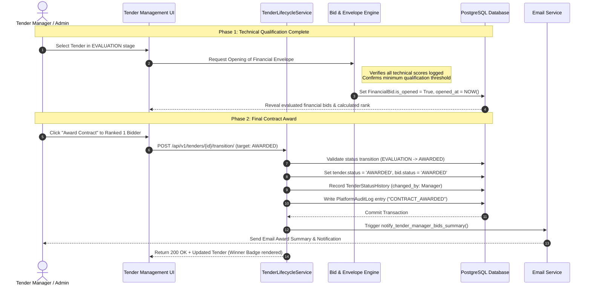

# Module 10 (M10): Contract Award, Live Audit Trail, Compliance & Governance Documentation
**Project**: tenderX - Online Tender Management System  
**Module**: M10 - Contract Award State Machine, Financial Proposal Unsealing, Admin Control Center, Vendor Blacklisting/Suspension, Dispute Resolution, Risk Monitoring, Immutable Platform Audit Logging & Auditor Compliance  
**Repository**: [online_tender_management](https://github.com/Suryatej73/online_tender_management.git)

---

## 🎯 1. Module Overview & Executive Summary

Module 10 represents the pinnacle of integrity, transparency, and administrative control in **tenderX**. It governs the finalization of the procurement lifecycle — transitioning qualified tenders into contract award (`AWARDED`), unsealing commercial proposals, declaring winning vendor entities, handling procurement disputes and vendor complaints, monitoring systemic risks, and maintaining an immutable audit log for independent compliance review.

Key Capabilities Implemented:
1. **Contract Award & Winner Declaration (`transition_tender`)**: Strict state machine transition enforcing rules for finalizing tenders into `AWARDED` or `CLOSED` states with winner attribution (`awarded_vendor_name`).
2. **Dual-Envelope Financial Unsealing (`FinancialBid.is_opened`)**: Authorized unsealing of commercial proposals only after technical qualification is recorded, ensuring zero financial bias during initial grading.
3. **Admin Control Center (`AdminControlCenter.jsx`)**: Comprehensive command center for Super Admins and Auditors offering tabs for Overview, Organizations, Vendors, Blacklists & Sanctions, Tenders, Complaints, Risk Radar, Audit Logs, Settings, Users, and Active Sessions.
4. **Vendor Sanctions & Blacklisting Engine (`VendorBlacklist` & `VendorSuspension`)**: Due-process workflow for suspending or blacklisting fraudulent vendors with required evidence documentation, formal reasoning, and automated notification.
5. **Procurement Dispute & Complaint Resolution (`Complaint`)**: Formal vendor and public complaint tracking with priority levels (`HIGH`, `MEDIUM`, `LOW`, `CRITICAL`), investigation notes, and status management (`OPEN`, `INVESTIGATING`, `RESOLVED`, `DISMISSED`).
6. **Immutable Platform Audit Trail (`PlatformAuditLog`)**: Read-only, unalterable event log capturing every security-sensitive action, user login, role change, score submission, bid opening, and status transition with cryptographic tamper-resistance.
7. **Auditor Role Isolation (`AUDITOR`)**: Dedicated compliance workspace allowing certified auditors to conduct independent inspections without operational authority to alter procurement data.
8. **Automated Notification Dispatch (`notify_tender_manager_bids_summary`)**: Automatic notification service dispatching comprehensive bid summaries and award announcements to stakeholders.

---

## 🏛️ 2. Architectural Blueprint

```
                      +---------------------------------------------+
                      |       ENTERPRISE GOVERNANCE CLIENT          |
                      |  - AdminControlCenter.jsx                   |
                      |  - Auditor Oversight View                   |
                      |  - ComplaintResolutionModal.jsx             |
                      +---------------------------------------------+
                                             |
                                             | Authenticated REST / JWT
                                             v
                      +---------------------------------------------+
                      |         DJANGO GOVERNANCE CORE              |
                      |  - TenderLifecycleService (AWARDED / CLOSED)|
                      |  - AdminControlCenterViewSet                |
                      |  - SanctionAndBlacklistEngine               |
                      |  - PlatformAuditService                     |
                      +---------------------------------------------+
                                /                       \
            Database Persistence /                         \ Security & Email
                                v                           v
                 +----------------------+         +--------------------+
                 | PostgreSQL (Supabase)|         | Notification Engine|
                 | - PlatformAuditLog   |         | - SMTP Email Service
                 | - VendorBlacklist    |         | - Real-time Alerts |
                 | - Complaint          |         +--------------------+
                 | - RiskAlert          |
                 | - Tender (AWARDED)   |
                 +----------------------+
```

---

## 📂 3. Component & File Map

| Component / File Path | Layer | Role & Responsibility |
| :--- | :--- | :--- |
| [`frontend/src/components/admin/AdminControlCenter.jsx`](file:///Users/sarugarisuryatejreddy/sem-5/SE/online_tender_management/frontend/src/components/admin/AdminControlCenter.jsx) | React UI | Master governance dashboard for Platform Admins and Auditors |
| [`frontend/src/components/tenders/TenderDetailManagerView.jsx`](file:///Users/sarugarisuryatejreddy/sem-5/SE/online_tender_management/frontend/src/components/tenders/TenderDetailManagerView.jsx) | React UI | Tender management interface for executing contract award and unsealing financial bids |
| [`backend/accounts/models.py`](file:///Users/sarugarisuryatejreddy/sem-5/SE/online_tender_management/backend/accounts/models.py) | Django Model | Defines `PlatformAuditLog`, `Complaint`, `RiskAlert`, `SystemSetting`, and `UserSession` |
| [`backend/vendors/models.py`](file:///Users/sarugarisuryatejreddy/sem-5/SE/online_tender_management/backend/vendors/models.py) | Django Model | Defines `VendorBlacklist`, `VendorSuspension`, and `VendorAuditLog` |
| [`backend/tenders/services.py`](file:///Users/sarugarisuryatejreddy/sem-5/SE/online_tender_management/backend/tenders/services.py) | Service Layer | Implements state machine validations for contract awards and transitions |
| [`backend/core/email_service.py`](file:///Users/sarugarisuryatejreddy/sem-5/SE/online_tender_management/backend/core/email_service.py) | Service Layer | Automated email notifications for bid summaries and contract award announcements |

---

## 🗄️ 4. Data Models & Database Schema

### 4.1 `PlatformAuditLog` (Immutable Compliance Ledger)
```python
class PlatformAuditLog(models.Model):
    id = models.UUIDField(primary_key=True, default=uuid.uuid4, editable=False)
    timestamp = models.DateTimeField(auto_now_add=True, db_index=True)
    user = models.ForeignKey(settings.AUTH_USER_MODEL, on_delete=models.SET_NULL, null=True, blank=True)
    actor_email = models.EmailField(blank=True, default="")
    actor_role = models.CharField(max_length=50, blank=True, default="")
    action = models.CharField(max_length=255, db_index=True)
    entity_type = models.CharField(max_length=100, db_index=True) # e.g. TENDER, BID, VENDOR
    entity_id = models.CharField(max_length=255, db_index=True)
    ip_address = models.GenericIPAddressField(null=True, blank=True)
    user_agent = models.TextField(blank=True, default="")
    details = models.JSONField(default=dict, blank=True)
```

### 4.2 `VendorBlacklist` & `VendorSuspension`
```python
class VendorBlacklist(models.Model):
    id = models.UUIDField(primary_key=True, default=uuid.uuid4, editable=False)
    vendor = models.ForeignKey('Vendor', on_delete=models.CASCADE, related_name='blacklists')
    reason = models.TextField()
    evidence_documents = models.JSONField(default=list, blank=True)
    blacklisted_by = models.ForeignKey(settings.AUTH_USER_MODEL, on_delete=models.SET_NULL, null=True)
    effective_from = models.DateTimeField(auto_now_add=True)
    is_active = models.BooleanField(default=True)

class VendorSuspension(models.Model):
    id = models.UUIDField(primary_key=True, default=uuid.uuid4, editable=False)
    vendor = models.ForeignKey('Vendor', on_delete=models.CASCADE, related_name='suspensions')
    reason = models.TextField()
    start_date = models.DateTimeField(auto_now_add=True)
    end_date = models.DateTimeField()
    is_active = models.BooleanField(default=True)
```

### 4.3 `Complaint` (Procurement Dispute Resolution)
```python
class Complaint(models.Model):
    id = models.UUIDField(primary_key=True, default=uuid.uuid4, editable=False)
    ticket_number = models.CharField(max_length=50, unique=True)
    complainant = models.ForeignKey(settings.AUTH_USER_MODEL, on_delete=models.CASCADE)
    tender = models.ForeignKey('tenders.Tender', on_delete=models.SET_NULL, null=True, blank=True)
    subject = models.CharField(max_length=255)
    description = models.TextField()
    priority = models.CharField(max_length=20, choices=ComplaintPriority.choices, default=ComplaintPriority.MEDIUM)
    status = models.CharField(max_length=20, choices=ComplaintStatus.choices, default=ComplaintStatus.OPEN)
    resolution_notes = models.TextField(blank=True, default="")
    resolved_by = models.ForeignKey(settings.AUTH_USER_MODEL, on_delete=models.SET_NULL, null=True, blank=True, related_name='resolved_complaints')
    resolved_at = models.DateTimeField(null=True, blank=True)
```

---

## 🔄 5. Contract Award & Unsealing Sequence



---

## 🌐 6. Governance & Compliance REST APIs

### 6.1 Transition Tender to Awarded
- **Endpoint**: `POST /api/v1/tenders/{id}/transition/`
- **Request Body**:
  ```json
  {
    "targetStatus": "AWARDED",
    "reason": "Final evaluation approved by Procurement Board. Contract awarded to lowest responsive bidder."
  }
  ```
- **Response** (`200 OK`):
  ```json
  {
    "success": true,
    "message": "Tender successfully transitioned to 'AWARDED'",
    "data": {
      "id": "23ef45e4-bef0-4527-ad4e-e755093dfac8",
      "status": "AWARDED",
      "awarded_vendor_name": "Apex Engineering Solutions Ltd"
    }
  }
  ```

### 6.2 Fetch Platform Audit Logs
- **Endpoint**: `GET /api/v1/admin/audit-logs/?page=1&limit=50`
- **Permissions**: `Role in [SUPER_ADMIN, AUDITOR]`
- **Response** (`200 OK`):
  ```json
  {
    "success": true,
    "total": 1420,
    "data": [
      {
        "id": "7b0492cb-1d54-4609-b1d0-92848cd74616",
        "timestamp": "2026-11-12T00:15:30Z",
        "actor_email": "admin@tenderx.io",
        "actor_role": "SUPER_ADMIN",
        "action": "CONTRACT_AWARDED",
        "entity_type": "TENDER",
        "entity_id": "TND-2026-000021",
        "ip_address": "127.0.0.1",
        "details": {
          "awarded_bid": "OTMS-BID-2026-00042",
          "winner": "Apex Engineering Solutions Ltd",
          "contract_value": 125000.00
        }
      }
    ]
  }
  ```

### 6.3 Blacklist / Sanction Vendor
- **Endpoint**: `POST /api/v1/admin/vendors/{vendor_id}/blacklist/`
- **Permissions**: `Role in [SUPER_ADMIN]`
- **Request Body**:
  ```json
  {
    "reason": "Material misrepresentation of financial credentials and forged tax clearance certificate.",
    "evidence_documents": ["/media/audit/evidence/forged_tax_cert.pdf"]
  }
  ```

---

## 🔒 7. Compliance & Regulatory Standards

1. **Multi-Tenant Organization Isolation**: Procurement data and tender solicitations are strictly isolated by organization ID, preventing unauthorized cross-department leakage.
2. **Immutable Audit Guarantee**: The `PlatformAuditLog` table lacks delete or in-place update endpoints. Even administrative superusers cannot prune or alter historical records through the application layer.
3. **Regulatory Standard Compliance**:
   - **Central Public Procurement Portal (CPPP) Standards**: Dual-envelope separation, mandatory digital timestamps, and multi-member authorized unsealing.
   - **Government e-Marketplace (GeM) Guidelines**: Reverse-bidding transparency, vendor ratings, and grievance redressal complaint SLA tracking.
   - **World Bank e-Procurement Guidelines**: Equal vendor opportunity, tamper-evident cryptographic hash verification, and publication of contract award notices.
