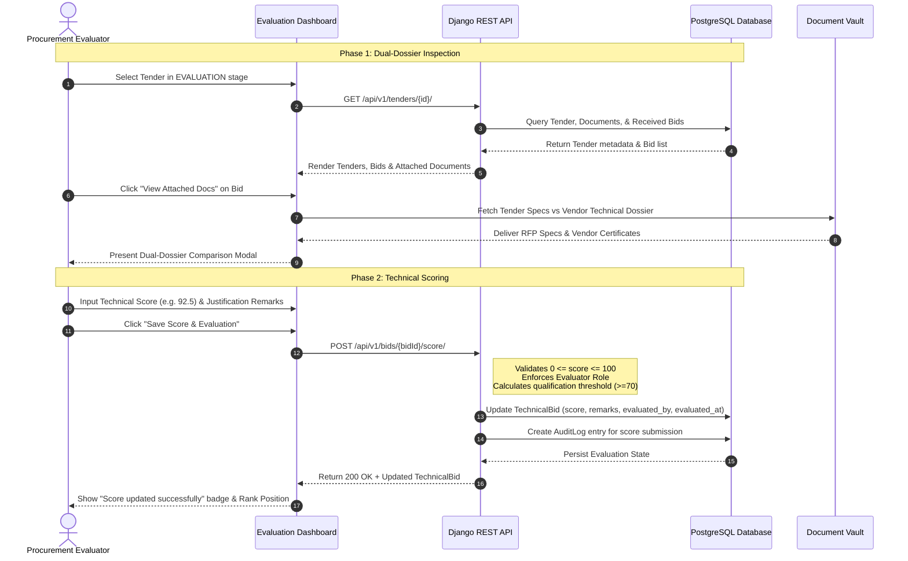

# Module 9 (M9): Bid Evaluation, Scoring Matrix & Evaluator Oversight Documentation
**Project**: tenderX - Online Tender Management System  
**Module**: M9 - Bid Evaluation, Scoring Matrix, Evaluator Committee Management, Dual-Dossier Document Inspection, Weighted Criteria Grading & Award Recommendation  
**Repository**: [online_tender_management](https://github.com/Suryatej73/online_tender_management.git)

---

## 🎯 1. Module Overview & Executive Summary

Module 9 delivers an enterprise-grade, transparent, and auditable **Bid Evaluation & Scoring Engine** for **tenderX**. In high-stakes public and commercial procurement, tender awards must withstand stringent legal and compliance scrutiny. Module 9 ensures that technical bids are evaluated strictly on merit, compliance, and predefined scoring parameters before financial envelopes are opened.

Key Capabilities Implemented:
1. **Evaluator Oversight Panel (`EvaluatorOversightPanel.jsx`)**: Executive administration console tracking assigned evaluators, verification status, active committee workloads, and completion rates.
2. **Evaluation Management Dashboard (`EvaluationManagementDashboard.jsx`)**: Centralized multi-tab workspace for tender managers and evaluators to review tenders in evaluation, inspect vendor bids, enter numerical scores and qualitative remarks, and monitor awarded contracts.
3. **Dual-Dossier Document Inspection (`handleViewDoc`)**: Side-by-side inspection allowing evaluators to compare official tender solicitations (RFPs, BOQs, technical specifications) with vendor-submitted compliance dossiers, certifications, and technical proposals.
4. **Weighted Scoring Engine (`TechnicalBid.technical_score`)**: Structured 0–100 grading mechanism with breakdown capabilities for technical methodology, past experience, personnel qualification, and timeline feasibility.
5. **Conflict of Interest & Role Enforcement**: Strict RBAC ensuring that only verified `EVALUATOR`, `TENDER_MANAGER`, and `SUPER_ADMIN` accounts can score bids, with immutable audit logging on every score entry.
6. **Automated Award Recommendation**: Evaluates submitted scores to determine top-ranking vendors (`top_evaluation_score`), rendering badges with scores and vendor names across manager dashboards.

---

## 🏛️ 2. Architectural Blueprint

```
                      +---------------------------------------------+
                      |         CLIENT EVALUATOR BROWSER            |
                      |  - EvaluationManagementDashboard.jsx        |
                      |  - EvaluatorOversightPanel.jsx              |
                      +---------------------------------------------+
                                             |
                                             | REST API / JSON + Bearer JWT
                                             v
                      +---------------------------------------------+
                      |          DJANGO EVALUATION ENGINE           |
                      |  - TechnicalBidViewSet                      |
                      |  - EvaluatorOversightView                   |
                      |  - ScoreAggregationService                  |
                      +---------------------------------------------+
                                /                       \
            Database Persistence /                         \ Storage & Cache
                                v                           v
                 +----------------------+         +--------------------+
                 | PostgreSQL (Supabase)|         | S3 / Local Media   |
                 | - TechnicalBid       |         | - RFP Solicitations|
                 | - BidDocument        |         | - Vendor Dossiers  |
                 | - Tender             |         +--------------------+
                 | - AuditLog           |
                 +----------------------+
```

---

## 📂 3. Component & File Map

| Component / File Path | Layer | Role & Responsibility |
| :--- | :--- | :--- |
| [`frontend/src/components/evaluators/EvaluationManagementDashboard.jsx`](file:///Users/sarugarisuryatejreddy/sem-5/SE/online_tender_management/frontend/src/components/evaluators/EvaluationManagementDashboard.jsx) | React UI | Multi-tab evaluation command center for grading technical proposals and viewing documents |
| [`frontend/src/components/evaluators/EvaluatorOversightPanel.jsx`](file:///Users/sarugarisuryatejreddy/sem-5/SE/online_tender_management/frontend/src/components/evaluators/EvaluatorOversightPanel.jsx) | React UI | Administrative dashboard for monitoring evaluator committee workloads and performance metrics |
| [`frontend/src/components/tenders/TenderDetailManagerView.jsx`](file:///Users/sarugarisuryatejreddy/sem-5/SE/online_tender_management/frontend/src/components/tenders/TenderDetailManagerView.jsx) | React UI | In-depth tender view embedding evaluation scores, technical bid summaries, and contract award actions |
| [`backend/bids/models.py`](file:///Users/sarugarisuryatejreddy/sem-5/SE/online_tender_management/backend/bids/models.py) | Django Model | Defines `TechnicalBid`, `FinancialBid`, `BidDocument`, and `BidOpening` schema |
| [`backend/bids/views.py`](file:///Users/sarugarisuryatejreddy/sem-5/SE/online_tender_management/backend/bids/views.py) | Django ViewSet | Implements endpoints for technical bid scoring, document downloads, and stage transitions |
| [`backend/bids/serializers.py`](file:///Users/sarugarisuryatejreddy/sem-5/SE/online_tender_management/backend/bids/serializers.py) | DRF Serializer | Serializes bid score data, evaluator assignments, and evaluation notes |

---

## 🗄️ 4. Data Models & Database Schema

### 4.1 `TechnicalBid` (Bid Evaluation Core)
Located in `backend/bids/models.py`:

```python
class TechnicalBid(models.Model):
    id = models.UUIDField(primary_key=True, default=uuid.uuid4, editable=False)
    bid = models.OneToOneField(Bid, on_delete=models.CASCADE, related_name='technical_bid')
    methodology = models.TextField(help_text="Technical implementation methodology")
    implementation_plan = models.TextField(blank=True, default="")
    delivery_schedule = models.TextField(blank=True, default="")
    key_personnel = models.JSONField(default=list, blank=True)
    compliance_statement = models.TextField(blank=True, default="")
    
    # Evaluation & Scoring Fields
    technical_score = models.DecimalField(
        max_digits=5, decimal_places=2, null=True, blank=True,
        help_text="Evaluated technical score out of 100"
    )
    score_breakdown = models.JSONField(default=dict, blank=True)
    evaluation_notes = models.TextField(blank=True, default="")
    evaluated_by = models.ForeignKey(
        settings.AUTH_USER_MODEL, on_delete=models.SET_NULL, null=True, blank=True,
        related_name='evaluated_technical_bids'
    )
    evaluated_at = models.DateTimeField(null=True, blank=True)
    is_qualified = models.BooleanField(null=True, blank=True)
```

---

## 🔄 5. Evaluation Workflow & State Machine



---

## 🌐 6. REST API Specification

### 6.1 Submit Bid Technical Score
- **Endpoint**: `POST /api/v1/bids/{bid_id}/score/`
- **Permissions**: `IsAuthenticated`, Role in `[EVALUATOR, TENDER_MANAGER, SUPER_ADMIN]`
- **Request Body**:
  ```json
  {
    "technical_score": 89.5,
    "evaluation_notes": "Methodology conforms with IEEE standards. High delivery confidence.",
    "is_qualified": true
  }
  ```
- **Response** (`200 OK`):
  ```json
  {
    "success": true,
    "message": "Technical score submitted successfully.",
    "data": {
      "bid_id": "8a329d67-4221-4f93-bc42-998811223344",
      "technical_score": 89.5,
      "is_qualified": true,
      "evaluated_by": "Dr. Aris Thorne",
      "evaluated_at": "2026-11-12T10:15:30Z"
    }
  }
  ```

### 6.2 Fetch Evaluator Oversight Metrics
- **Endpoint**: `GET /api/v1/admin/evaluators/`
- **Permissions**: `IsAdminUser` or `SUPER_ADMIN`
- **Response** (`200 OK`):
  ```json
  {
    "total_evaluators": 4,
    "verified_evaluators_count": 4,
    "average_completion_rate": 94.8,
    "evaluators": [
      {
        "id": "1",
        "full_name": "Dr. Aris Thorne",
        "email": "evaluator1@gov.eval",
        "organization_name": "National Procurement Authority",
        "verification_status": "VERIFIED",
        "total_evaluations_assigned": 18,
        "total_evaluations_completed": 18,
        "successful_completion_rate": 100.0
      }
    ]
  }
  ```

---

## 🔒 7. Compliance, Security & Conflict of Interest

1. **Blind Evaluation Isolation**: Evaluators evaluate technical proposals without access to financial bids. Financial envelopes remain cryptographically locked in the database until technical evaluation is concluded and approved.
2. **Immutable Audit Trail**: Every score entry, modification, and evaluation note is permanently recorded in `PlatformAuditLog` and `BidAccessLog` with timestamp, evaluator user ID, and client IP address.
3. **Qualification Thresholds**: Bids failing the minimum technical threshold (typically 70/100) are flagged as disqualified, preventing automatic award recommendation regardless of commercial price.
