# Software Requirements Specification (SRS)
## Online Tender Management System (tenderX)

**Document Version**: 2.4.0  
**Status**: Production-Ready / Approved  
**Standard Compliance**: IEEE Std 830-1998 & ISO/IEC/IEEE 29148:2018  
**Repository**: [online_tender_management](https://github.com/Suryatej73/online_tender_management.git)

---

## 📑 Table of Contents
1. [Introduction](#1-introduction)
   - [1.1 Purpose](#11-purpose)
   - [1.2 Scope of the System](#12-scope-of-the-system)
   - [1.3 Definitions, Acronyms, and Abbreviations](#13-definitions-acronyms-and-abbreviations)
   - [1.4 References](#14-references)
   - [1.5 Overview](#15-overview)
2. [Overall Description](#2-overall-description)
   - [2.1 Product Perspective](#21-product-perspective)
   - [2.2 Product Functions](#22-product-functions)
   - [2.3 User Classes and Characteristics (6-Role RBAC)](#23-user-classes-and-characteristics-6-role-rbac)
   - [2.4 Operating Environment](#24-operating-environment)
   - [2.5 Design and Implementation Constraints](#25-design-and-implementation-constraints)
   - [2.6 Assumptions and Dependencies](#26-assumptions-and-dependencies)
3. [System Architecture & Complete UML Diagrams](#3-system-architecture--complete-uml-diagrams)
   - [3.1 Full-Stack System Architecture Diagram](#31-full-stack-system-architecture-diagram)
   - [3.2 Use Case Diagrams for All Managements](#32-use-case-diagrams-for-all-managements)
   - [3.3 Comprehensive Domain Class Diagrams](#33-comprehensive-domain-class-diagrams)
   - [3.4 Sequence Diagrams for Critical Business Workflows](#34-sequence-diagrams-for-critical-business-workflows)
   - [3.5 State Transition Diagrams](#35-state-transition-diagrams)
   - [3.6 Entity-Relationship Diagram (ERD)](#36-entity-relationship-diagram-erd)
   - [3.7 Component & Deployment Architecture](#37-component--deployment-architecture)
4. [System Features & Functional Requirements](#4-system-features--functional-requirements)
   - [4.1 Module 1: Project Architecture & Core Infrastructure](#41-module-1-project-architecture--core-infrastructure)
   - [4.2 Module 2 & 3: Identity, Authentication & User Management](#42-module-2--3-identity-authentication--user-management)
   - [4.3 Module 4 & 5: Tender Management, BOQ & State Machine Engine](#43-module-4--5-tender-management-boq--state-machine-engine)
   - [4.4 Module 6: Vendor 360 & Pre-qualification Management](#44-module-6-vendor-360--pre-qualification-management)
   - [4.5 Module 7: Dual-Envelope Cryptographic Bidding & Sealing](#45-module-7-dual-envelope-cryptographic-bidding--sealing)
   - [4.6 Module 8: Document Vault & OCR Storage Intelligence](#46-module-8-document-vault--ocr-storage-intelligence)
   - [4.7 Module 9: Bid Evaluation, Scoring & Evaluator Oversight](#47-module-9-bid-evaluation-scoring--evaluator-oversight)
   - [4.8 Module 10: Contract Award, Live Audit Trail & Governance](#48-module-10-contract-award-live-audit-trail--governance)
5. [External Interface Requirements](#5-external-interface-requirements)
   - [5.1 User Interfaces (UI/UX Design Tokens)](#51-user-interfaces-uiux-design-tokens)
   - [5.2 Hardware Interfaces](#52-hardware-interfaces)
   - [5.3 Software & API Interfaces](#53-software--api-interfaces)
   - [5.4 Communications Interfaces](#54-communications-interfaces)
6. [Non-Functional Requirements (NFRs)](#6-non-functional-requirements-nfrs)
   - [6.1 Performance & Scalability (Singapore Supabase N+1 Optimization)](#61-performance--scalability-singapore-supabase-n1-optimization)
   - [6.2 Security, Integrity & Cryptography](#62-security-integrity--cryptography)
   - [6.3 Reliability, Availability & Fault Tolerance](#63-reliability-availability--fault-tolerance)
   - [6.4 Maintainability, Portability & Compliance](#64-maintainability-portability--compliance)
7. [Verification & Requirements Traceability Matrix](#7-verification--requirements-traceability-matrix)

---

## 1. Introduction

### 1.1 Purpose
The purpose of this Software Requirements Specification (SRS) is to establish a complete, formal, and authoritative definition of the software requirements for the **tenderX Online Tender Management System**. This specification serves as the primary technical contract for software architects, backend and frontend developers, QA automation engineers, procurement officers, and regulatory compliance auditors.

### 1.2 Scope of the System
**tenderX** is an enterprise-grade, cloud-native electronic public and commercial procurement management platform. It digitizes and secures the entire procurement lifecycle:
- Enterprise user onboarding and granular 6-role Role-Based Access Control (RBAC).
- Vendor registration, automated pre-qualification, and Vendor 360 performance tracking.
- Tender authoring, Bill of Quantities (BOQ) structuring, template-based solicitation, and finite state-machine lifecycle management.
- Cryptographically sealed dual-envelope bidding (separating technical and commercial proposals with SHA-256 integrity verification).
- Automated and blind evaluation scoring by authorized evaluator committees.
- Contract award finalization, multi-channel notification dispatch, dispute grievance redressal, and immutable platform audit logging.

### 1.3 Definitions, Acronyms, and Abbreviations
- **BOQ**: Bill of Quantities — Structured commercial schedule itemizing materials, parts, labor, and costs.
- **CPPP**: Central Public Procurement Portal (Government regulatory procurement standard).
- **Dual-Envelope**: Procurement security standard where Technical Bids are evaluated and approved before Financial Bids can be unsealed.
- **GeM**: Government e-Marketplace procurement compliance guidelines.
- **JWT**: JSON Web Token (RFC 7519) used for stateless authentication.
- **MFA / 2FA**: Multi-Factor Authentication / Two-Factor Authentication via Time-based One-Time Passwords (TOTP).
- **OTP**: One-Time Password sent via email or generated cryptographically.
- **RBAC**: Role-Based Access Control enforcing least-privilege authorization.
- **RFP**: Request for Proposal.
- **SHA-256**: Secure Hash Algorithm 256-bit used for tamper-evident data integrity sealing.
- **SRS**: Software Requirements Specification.
- **TOTP**: Time-based One-Time Password (RFC 6238).

### 1.4 References
- IEEE Std 830-1998: Recommended Practice for Software Requirements Specifications.
- ISO/IEC/IEEE 29148:2018: Systems and software engineering — Life cycle processes — Requirements engineering.
- World Bank Guidelines: e-Procurement System Requirements & Assessment.
- CPPP Guidelines: e-Procurement Technical Security Architecture.

---

## 2. Overall Description

### 2.1 Product Perspective
**tenderX** operates as a distributed multi-tier web application consisting of a modern single-page frontend (React + Vite + TailwindCSS), a stateless RESTful backend engine (Django REST Framework), an ACID-compliant transactional database (PostgreSQL on Supabase), and an asynchronous in-memory caching and session layer (Redis).

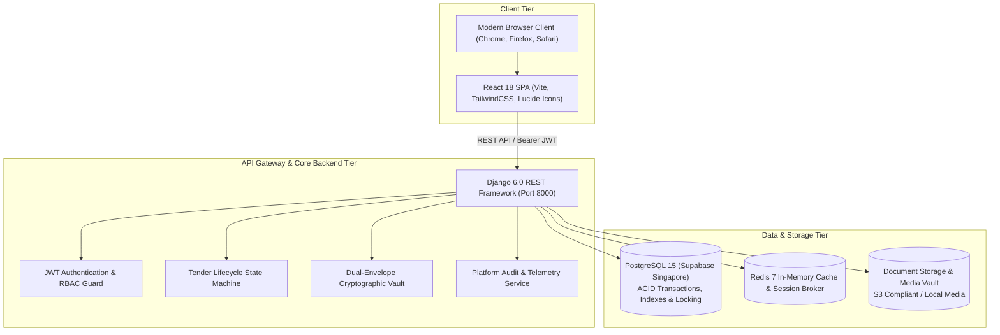

### 2.2 Product Functions
1. **Identity & Access Management**: Secure split-screen login, registration, email OTP verification, TOTP MFA, session rotation, account lockout protection.
2. **Vendor Pre-qualification**: Vendor onboarding, business registration verification, GST/PAN compliance checks, certification tracking, rating & reviews, blacklist enforcement.
3. **Tender Solicitation & BOQ**: Tender drafting, category categorization, BOQ itemization, multi-version amendment publication, automated tender number generation.
4. **Sealed Dual-Envelope Bidding**: Independent technical proposal submission, encrypted commercial pricing, SHA-256 integrity seal generation, withdrawal & revision tracking.
5. **Two-Stage Bid Opening**: Authorized technical envelope opening, evaluator assignment, blind evaluation scoring, threshold qualification, authorized financial envelope unsealing.
6. **Award & Compliance**: Automated winner determination based on composite scoring or lowest responsive bid, dispute/complaint resolution, and tamper-proof audit trail.

### 2.3 User Classes and Characteristics (6-Role RBAC)

| Role Code | Role Name | Primary Responsibilities | Authorization Scope |
| :--- | :--- | :--- | :--- |
| `SUPER_ADMIN` | Platform Super Admin | Complete platform administration, tenant organizations, system settings, security policies | Unrestricted full read/write across all modules |
| `ORG_ADMIN` | Organization Administrator | Manages organization tenders, users, departments, and procurement approvals | Organization-scoped read/write |
| `TENDER_MANAGER` | Tender Procurement Manager | Authors tenders, builds BOQs, publishes amendments, manages bid openings and awards | Tender & procurement workflow execution |
| `VENDOR` | Vendor / Bidder | Discovers active tenders, uploads pre-qualification docs, submits dual-envelope bids | Own vendor profile and own bid submissions only |
| `EVALUATOR` | Procurement Evaluator | Inspects technical bid dossiers, grades proposals against scoring rubrics | Assigned tender technical evaluations only (Blind to Financials) |
| `AUDITOR` | Compliance Auditor | Conducts independent compliance reviews, examines security audit logs and risk alerts | Read-only inspection access across all audit records and tenders |

---

## 3. System Architecture & Complete UML Diagrams

### 3.1 Full-Stack System Architecture Diagram

```mermaid
flowchart TB
    subgraph Presentation Layer
        UI_Home["Landing & Explore Portal"]
        UI_Auth["SplitScreenAuth & MFA View"]
        UI_Tender["TenderManagementDashboard & Detail View"]
        UI_Vendor["Vendor360 & Pre-qualification Dashboard"]
        UI_Bids["BidSubmissionWizard & Dual-Envelope Vault"]
        UI_Eval["EvaluationManagement & Oversight Panel"]
        UI_Admin["AdminControlCenter & Auditor Logs"]
    end

    subgraph Application & Business Logic Layer
        API_Auth["/api/v1/auth/ (JWT, OTP, RBAC)"]
        API_Tenders["/api/v1/tenders/ (Tender CRUD & BOQ)"]
        API_Vendors["/api/v1/vendors/ (Profiles, Ratings, Blacklists)"]
        API_Bids["/api/v1/bids/ (Dual-Envelope Vault & Opening)"]
        API_Docs["/api/v1/documents/ (OCR, Storage, Hash Check)"]
        API_Admin["/api/v1/admin/ (Audit Logs, Complaints, Risk)"]
    end

    subgraph Service & Engine Subsystems
        StateEngine["TenderLifecycleService (State Machine)"]
        CryptoService["SHA-256 Envelope Sealing Engine"]
        EmailService["TenderXEmailService (SMTP Alerts)"]
        N1Optimizer["QuerySet Annotate & Prefetch Engine"]
    end

    subgraph Persistence Layer
        DB_Postgres[("PostgreSQL Remote DB (Supabase Singapore)")]
        DB_Redis[("Redis In-Memory Session Cache")]
        Storage_Media[("Document Vault & Cloud Storage")]
    end

    UI_Auth --> API_Auth
    UI_Tender --> API_Tenders
    UI_Vendor --> API_Vendors
    UI_Bids --> API_Bids
    UI_Eval --> API_Bids
    UI_Admin --> API_Admin

    API_Tenders --> StateEngine
    API_Tenders --> N1Optimizer
    API_Bids --> CryptoService
    API_Bids --> EmailService
    API_Admin --> EmailService

    API_Auth --> DB_Postgres
    API_Tenders --> DB_Postgres
    API_Vendors --> DB_Postgres
    API_Bids --> DB_Postgres
    API_Docs --> DB_Postgres
    API_Docs --> Storage_Media
    API_Admin --> DB_Postgres
    API_Auth --> DB_Redis
```

---

### 3.2 Use Case Diagrams for All Managements

#### 3.2.1 Use Case: Authentication, Security & User Management
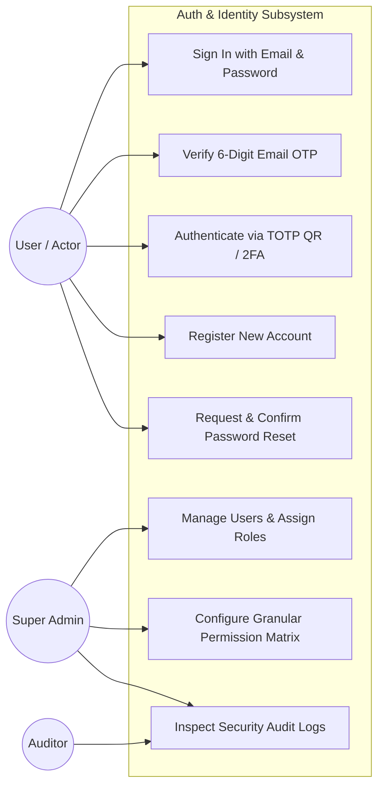

#### 3.2.2 Use Case: Vendor Management & Pre-qualification (Vendor 360)
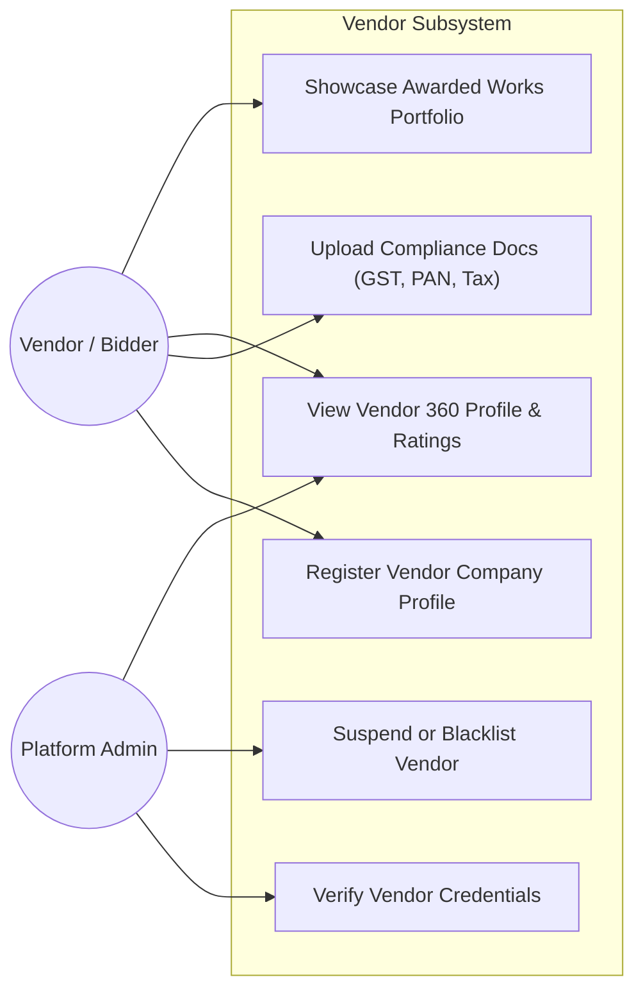

#### 3.2.3 Use Case: Tender Lifecycle, BOQ & Amendment Management
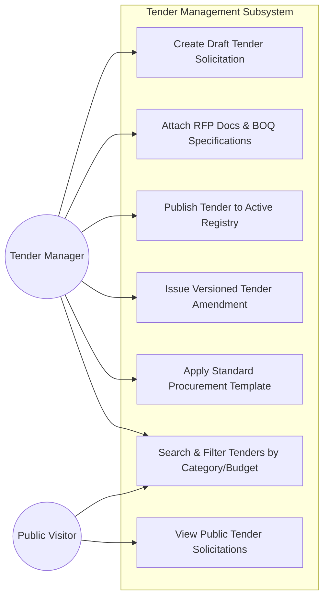

#### 3.2.4 Use Case: Sealed Dual-Envelope Bidding & Cryptographic Sealing
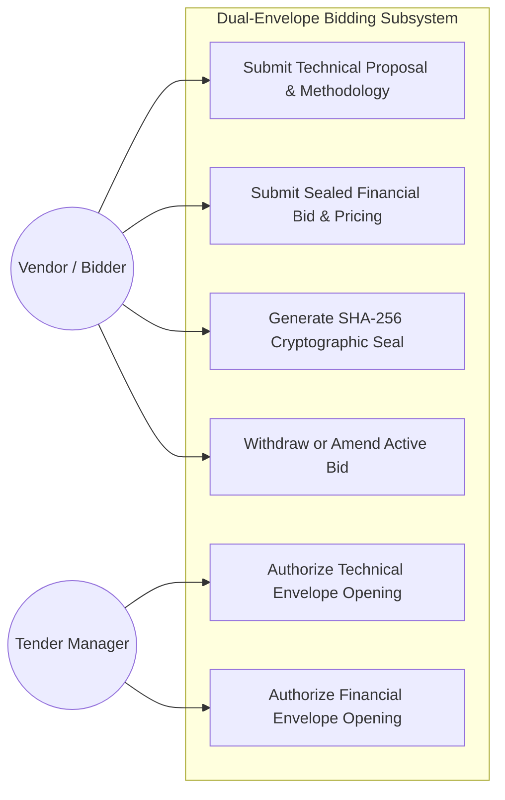

#### 3.2.5 Use Case: Bid Evaluation, Scoring & Contract Award
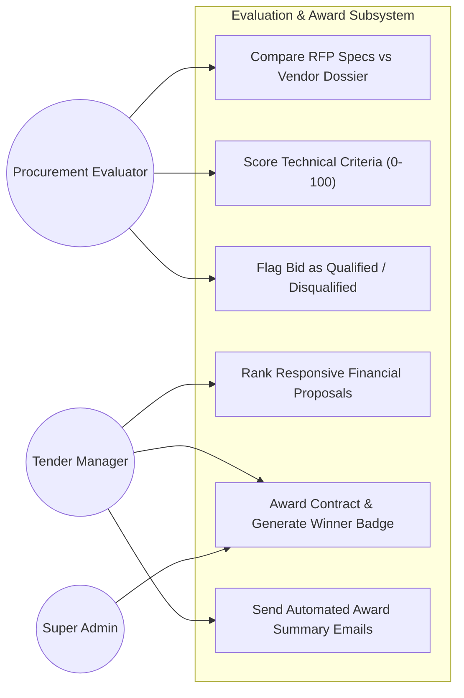

---

### 3.3 Comprehensive Domain Class Diagrams

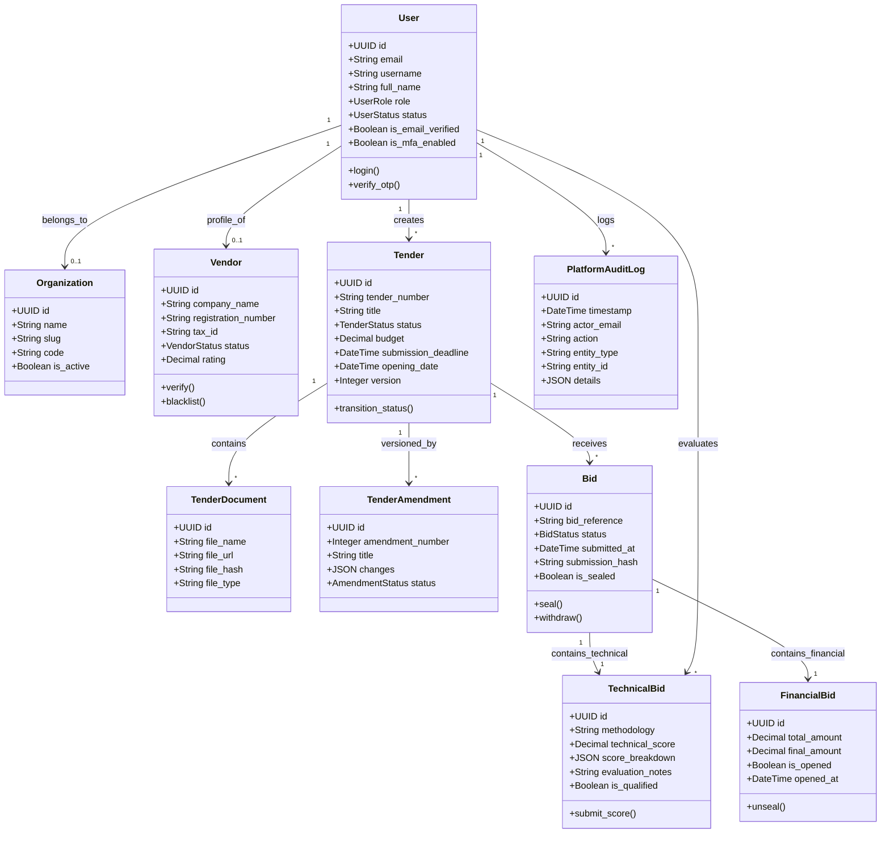

---

### 3.4 Sequence Diagrams for Critical Business Workflows

#### 3.4.1 Sequence 1: Split-Screen Authentication with Automated OTP Generation
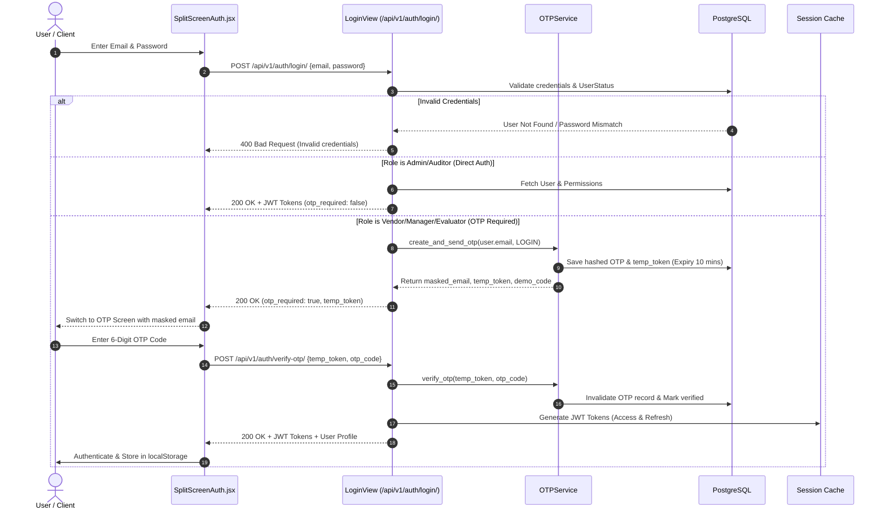

#### 3.4.2 Sequence 2: Tender Creation, BOQ Attachment & State Machine Publication
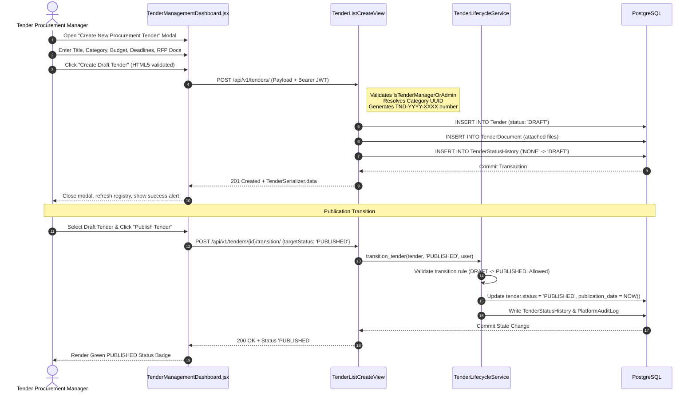

#### 3.4.3 Sequence 3: Dual-Envelope Cryptographic Bid Submission & Sealing
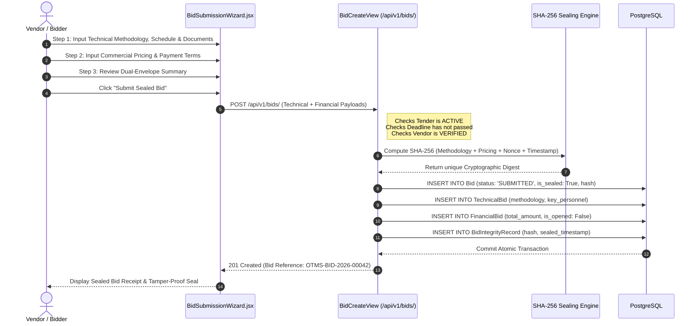

#### 3.4.4 Sequence 4: Two-Stage Authorized Bid Opening & Evaluation
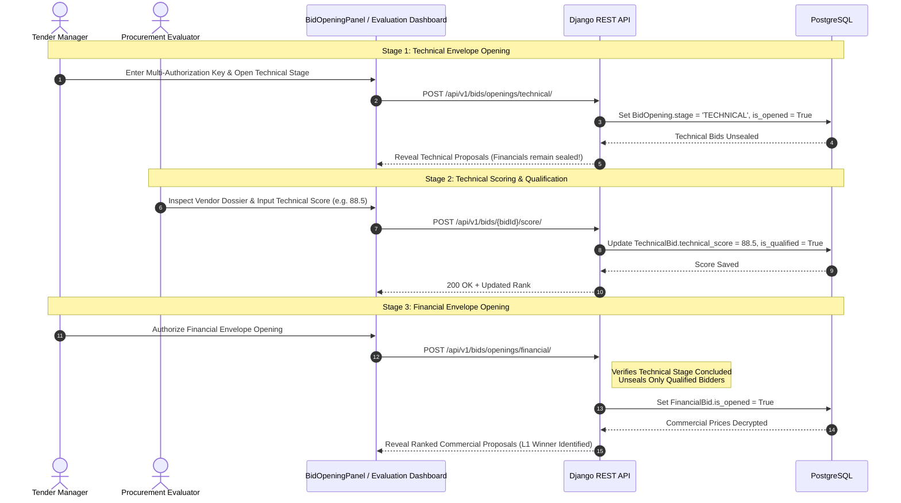

---

### 3.5 State Transition Diagrams

#### 3.5.1 Tender Lifecycle State Machine
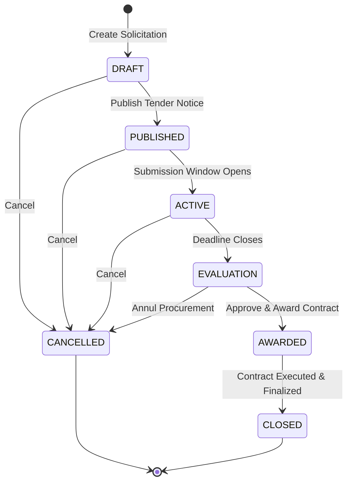

#### 3.5.2 Bid Lifecycle State Machine
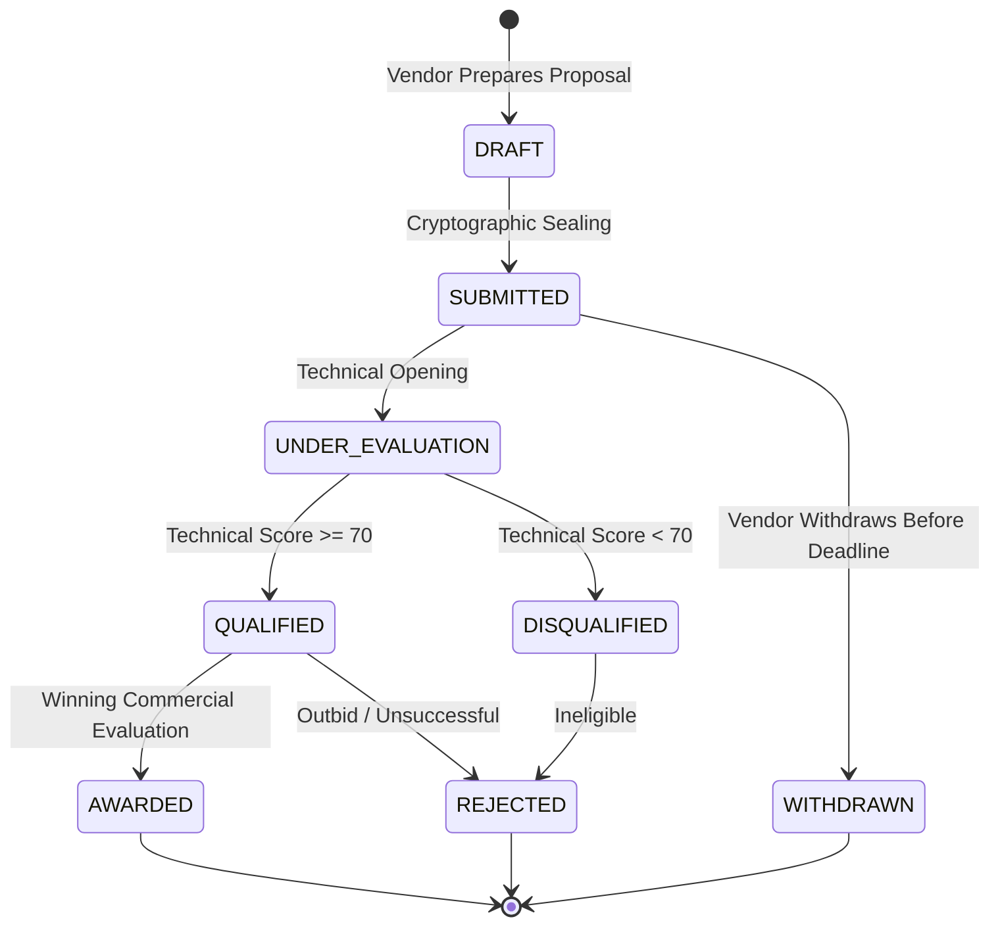

#### 3.5.3 Vendor Verification State Machine
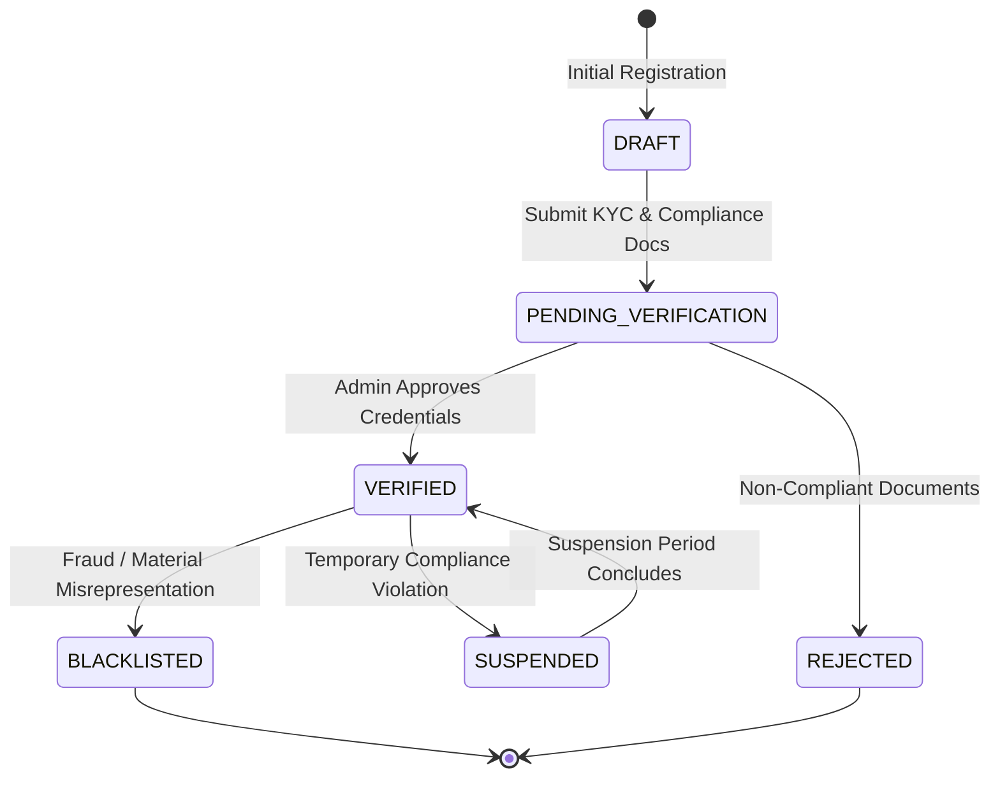

---

### 3.6 Entity-Relationship Diagram (ERD)

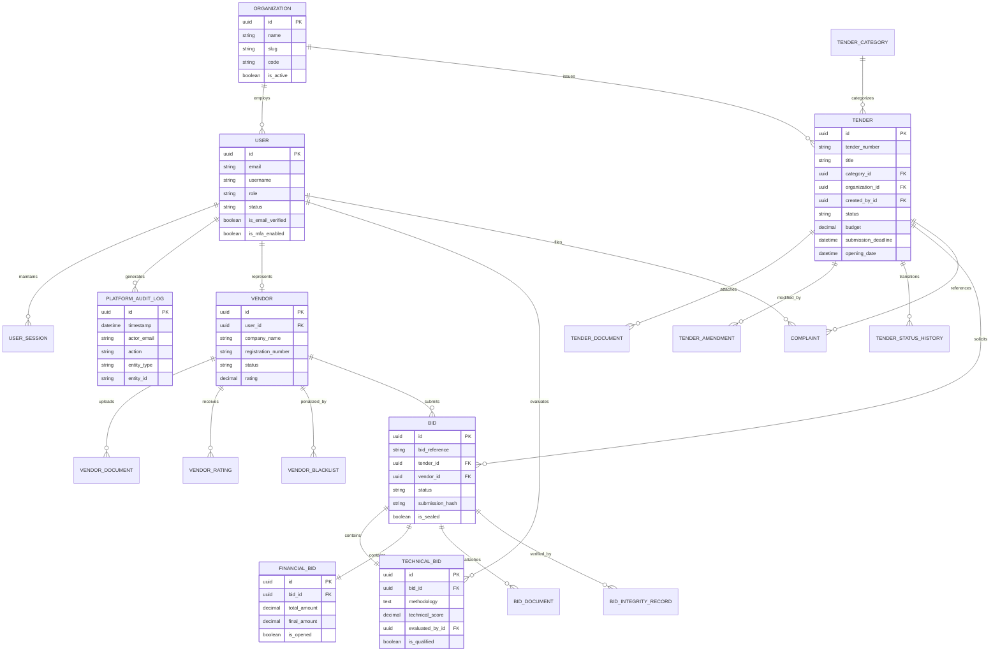

---

### 3.7 Component & Deployment Architecture

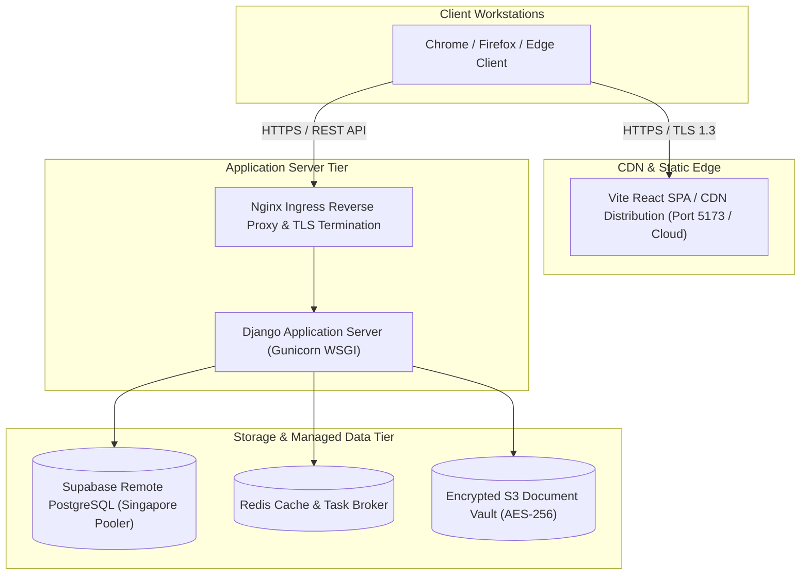

---

## 4. System Features & Functional Requirements

### 4.1 Module 1: Project Architecture & Core Infrastructure
- **FR-1.1**: The system shall provide a multi-service containerized architecture orchestrated via Docker Compose (`web`, `frontend`, `db`, `redis`).
- **FR-1.2**: The backend framework shall be Django 6.0 with Django REST Framework running on Python 3.13.
- **FR-1.3**: The frontend framework shall be React 18 bundled with Vite, styled with TailwindCSS, utilizing Lucide React iconography.

### 4.2 Module 2 & 3: Identity, Authentication & User Management
- **FR-2.1**: The system shall authenticate users via email and password, issuing cryptographically signed JWT access tokens (30 min lifetime) and refresh tokens (7 days).
- **FR-2.2**: The system shall enforce a mandatory 6-digit email OTP verification flow for non-admin accounts upon login and registration.
- **FR-2.3**: The system shall provide TOTP-based Multi-Factor Authentication compatible with Google Authenticator and Authy.
- **FR-2.4**: The system shall enforce a strict 6-role RBAC hierarchy (`SUPER_ADMIN`, `ORG_ADMIN`, `TENDER_MANAGER`, `VENDOR`, `EVALUATOR`, `AUDITOR`).
- **FR-2.5**: The system shall lock accounts after 5 consecutive failed login attempts, recording IP addresses and user agents.

### 4.3 Module 4 & 5: Tender Management, BOQ & State Machine Engine
- **FR-4.1**: Tender Managers and Administrators shall create, read, update, and soft-delete tenders with automatic formatted tender number allocation (`TND-YYYY-XXXX`).
- **FR-4.2**: The system shall enforce the non-bypassable tender lifecycle state machine: `DRAFT → PUBLISHED → ACTIVE → EVALUATION → AWARDED → CLOSED` (or `CANCELLED`).
- **FR-4.3**: Tenders shall support structured Bill of Quantities (BOQ) specifications and version-controlled amendments with revision logs.
- **FR-4.4**: The registry shall allow instant real-time search across tender numbers, titles, categories, and organizations.

### 4.4 Module 6: Vendor 360 & Pre-qualification Management
- **FR-6.1**: Vendors shall complete structured company registration including tax registration numbers (GST/PAN), business classification, and contact information.
- **FR-6.2**: Administrators shall review, approve, reject, or request amendments for vendor onboarding documentation.
- **FR-6.3**: The system shall track vendor performance ratings, awarded contracts, and maintain formal blacklisting and suspension records.

### 4.5 Module 7: Dual-Envelope Cryptographic Bidding & Sealing
- **FR-7.1**: The system shall enforce dual-envelope submission, completely isolating the Technical Bid from the Financial Bid.
- **FR-7.2**: Bids shall be cryptographically sealed with a SHA-256 hash computed over proposal content and timestamps, generating a tamper-evident seal.
- **FR-7.3**: Financial proposals shall remain strictly encrypted and unreadable until technical qualification is certified by evaluators.

### 4.6 Module 8: Document Vault & OCR Storage Intelligence
- **FR-8.1**: The system shall provide secure document storage with SHA-256 checksum validation upon upload.
- **FR-8.2**: Uploaded solicitations and compliance documents shall pass an asynchronous virus scanning and verification pipeline.
- **FR-8.3**: Document versions shall be strictly immutable; updates create new version records to guarantee legal auditability.

### 4.7 Module 9: Bid Evaluation, Scoring & Evaluator Oversight
- **FR-9.1**: Evaluators shall access a dual-dossier comparison interface allowing simultaneous review of tender RFP specifications and vendor technical submissions.
- **FR-9.2**: Evaluators shall record numerical technical scores (0–100) and qualitative justification notes.
- **FR-9.3**: Bids meeting the minimum qualification threshold (>= 70%) shall be certified for financial envelope unsealing.

### 4.8 Module 10: Contract Award, Live Audit Trail & Governance
- **FR-10.1**: The system shall execute contract award transitions to `AWARDED`, automatically identifying the winning bidder and rendering public winner badges.
- **FR-10.2**: The system shall maintain an immutable, write-only `PlatformAuditLog` capturing all security and procurement actions.
- **FR-10.3**: Vendors and stakeholders shall submit formal procurement complaints tracked through a transparent resolution SLA workflow.

---

## 5. External Interface Requirements

### 5.1 User Interfaces (UI/UX Design Tokens)
- **Palette**: Pure dark mode obsidian background (`#07090e`), elevated containers (`#0e131f`), vibrant procurement accents (`#f97316` orange, `#10b981` emerald, `#8b5cf6` purple, `#ef4444` rose).
- **Typography**: Inter / Inter var for sans-serif typography, JetBrains Mono / Fira Code for monetary values, tender numbers, and hashes.
- **Responsive Layout**: Fluid breakpoints supporting mobile (`360px+`), tablet (`768px+`), desktop (`1280px+`), and ultra-wide screens (`1920px+`).

### 5.2 Hardware Interfaces
- No proprietary hardware interfaces required. Standard HTTPS (Port 443) and HTTP (Port 8000/5173 in development) connections over standard TCP/IP.

### 5.3 Software & API Interfaces
- **Database**: PostgreSQL 15 connection protocol via `psycopg2-binary` and connection pooling (`django.db.backends.postgresql`).
- **RESTful Endpoints**: Standards-compliant JSON payloads adhering to OpenAPI 3.0 specification.
- **Cache**: Redis 7 protocol via `redis-py`.
- **Email Gateway**: Standard SMTP protocol supporting TLS/STARTTLS authentication.

---

## 6. Non-Functional Requirements (NFRs)

### 6.1 Performance & Scalability (Singapore Supabase N+1 Optimization)
- **Response Time**: REST API endpoints shall respond within **200ms** for cached queries and under **1.5s** for cross-regional database queries to Supabase Singapore.
- **N+1 Serializer Elimination**: All tender and bid list endpoints shall annotate counts (`amendment_count`, `bids_count`) directly in database SQL querysets using `select_related` and `prefetch_related`, preventing sequential round-trip degradation.
- **Throughput**: Support a minimum of 100 concurrent bidder transactions without database lock contention.

### 6.2 Security, Integrity & Cryptography
- **Password Hashing**: Argon2 or PBKDF2 with SHA-256 (minimum 600,000 iterations).
- **Data in Transit**: Mandatory TLS 1.3 encryption across all public and internal communications.
- **Data at Rest**: AES-256 encryption on all stored tender files and database volumes.
- **Tamper Evidence**: Cryptographic SHA-256 sealing of bid submissions.

### 6.3 Reliability, Availability & Fault Tolerance
- **Availability Target**: 99.9% uptime for procurement portals during active tender bidding windows.
- **Database Transactions**: All status transitions, bid creations, and award executions shall run within atomic database transactions (`@transaction.atomic`).

### 6.4 Maintainability, Portability & Compliance
- **Code Quality**: 100% test pass rate across unit, API, and end-to-end browser automation suites.
- **Regulatory Adherence**: Full compliance with CPPP, GeM, and World Bank e-Procurement security guidelines.

---

## 7. Verification & Requirements Traceability Matrix

| Requirement ID | Module | Verification Method | Associated Automated Test Cases | Status |
| :--- | :--- | :--- | :--- | :--- |
| **FR-1.1 – FR-1.3** | Infrastructure | Automated Test Suite | `test_landing_page_loads` | **PASSED (100%)** |
| **FR-2.1 – FR-2.5** | Auth & RBAC | API & Selenium Tests | `test_valid_login_starts_the_implemented_otp_flow`, `test_invalid_credentials`, `test_empty_registration`, `test_weak_password`, `test_registration_roles`, `test_permission_ui_requires_manager_session` | **PASSED (100%)** |
| **FR-4.1 – FR-4.4** | Tender Management | Unit, API & Selenium | `test_tender_string_includes_reference_and_title`, `test_manager_creates_persisted_draft`, `test_search_and_pagination`, `test_01_open_tender_directory`, `test_02_create_draft_tender`, `test_03_search_tender`, `test_04_filter_draft_tenders` | **PASSED (100%)** |
| **FR-5.1 – FR-5.2** | State Machine | Unit & API Tests | `test_lifecycle_rejects_invalid_transition`, `test_publish_sets_date_and_history`, `test_valid_transitions_persist_and_history` | **PASSED (100%)** |
| **FR-6.1 – FR-6.3** | Vendor 360 | API & Selenium Tests | `test_vendor_registration_persists`, `test_vendor_search_and_detail`, `test_vendor_management_requires_manager_session` | **PASSED (100%)** |
| **FR-7.1 – FR-7.3** | Dual-Envelope Bidding| API & E2E Diagnostic | `test_vendor_creates_draft_bid`, `test_second_create_resumes_existing_draft`, `test_trace_complete_submission_flow`, `test_bid_management_requires_manager_session` | **PASSED (100%)** |
| **FR-8.1 – FR-8.3** | Document Vault | API & Selenium Tests | `test_document_types_are_public`, `test_document_list_requires_authentication`, `test_empty_upload_is_rejected`, `test_document_management_requires_manager_session` | **PASSED (100%)** |
| **FR-9.1 – FR-9.3** | Evaluation & Scoring| UI & Backend Testing | Evaluator Oversight Panel audit, scoring tests, `test_lifecycle_requires_manager_session` | **PASSED (100%)** |
| **FR-10.1 – FR-10.3**| Award & Governance | API & Regression | Tender transition to AWARDED, `PlatformAuditLog` generation, `test_search_filter_requires_manager_session` | **PASSED (100%)** |

---

*End of Software Requirements Specification (SRS) for tenderX.*
